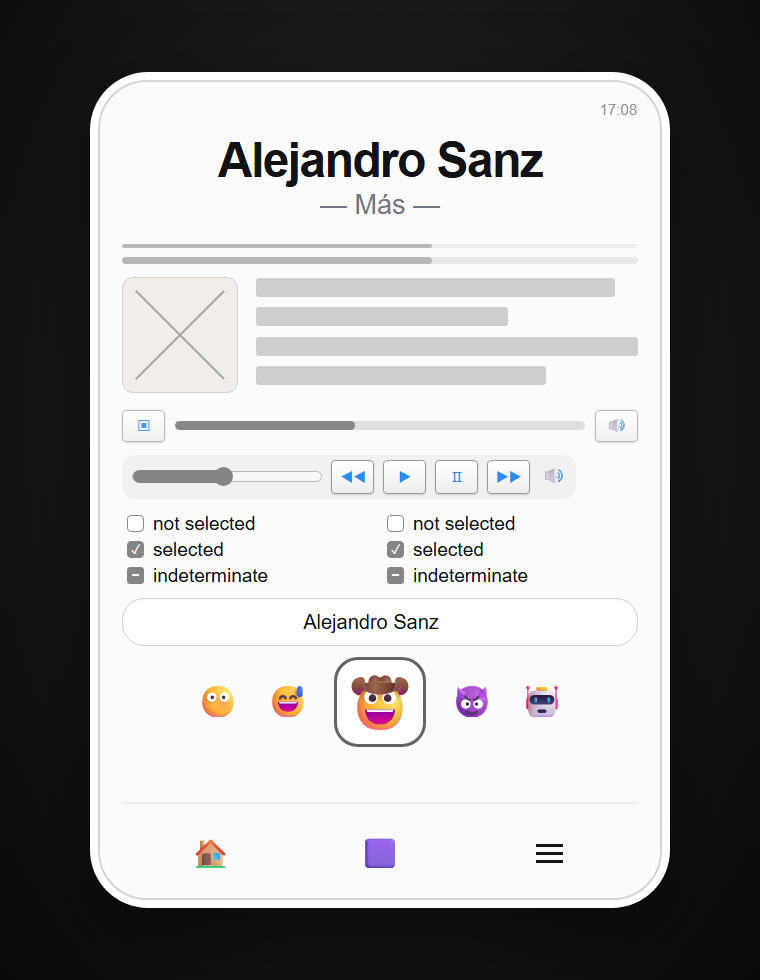

# Reproductor musical: Más

Mockup responsive de un reproductor musical realizado con React, Next.js y TypeScript. La interfaz recrea el diseño de referencia con una carcasa de dispositivo, el álbum **Más** de Alejandro Sanz, controles decorativos, estados de casillas, búsqueda, carrusel de emociones y navegación inferior. No reproduce audio ni implementa acciones de reproducción.

## Captura



## Cómo se creó

1. Se descompuso el mockup en secciones visuales independientes y se implementaron como componentes React.
2. Se centralizaron los datos de artistas en un único archivo para compartir las mismas propiedades entre componentes.
3. Se dejó el espacio del retrato como un marcador wireframe accesible, cruzado por dos diagonales.
4. Se aplicaron estilos globales con CSS para reproducir la jerarquía, los tonos y las proporciones del dispositivo, incluidos ajustes para pantallas pequeñas. El marcador del retrato es un recuadro accesible cruzado por dos diagonales.
5. Se integraron todos los componentes en la página principal de Next.js.

## Componentes

```text
app/
├── components/
│   ├── album-heading.tsx       # Nombre del artista y álbum
│   ├── album-progress.tsx      # Barras de progreso estáticas
│   ├── artist-card.tsx         # Marcador wireframe e información del artista
│   ├── artist-search.tsx       # Campo con el nombre del artista
│   ├── bottom-navigation.tsx   # Iconos de navegación
│   ├── checkbox-showcase.tsx   # Casillas vacías, marcadas y mixtas
│   ├── mood-carousel.tsx       # Carrusel con emoji central destacado
│   ├── player-screen.tsx       # Composición de la pantalla
│   └── transport-controls.tsx  # Controles de reproducción y volumen
├── data/
│   └── artists.ts              # Datos y selección del artista
├── globals.css                 # Estilos y adaptación responsive
└── page.tsx                    # Entrada de la aplicación
```

## Cambiar de cantante

Los datos de ambos artistas están centralizados en `app/data/artists.ts`. Para mostrar a David Bisbal, cambia únicamente el valor de `selectedArtistKey` a `"bisbal"`. El nombre y el subtítulo se reciben por props con valores predeterminados de Alejandro Sanz. La tarjeta reserva el espacio del retrato con un marcador cuadrado cruzado por diagonales.

Para añadir otro cantante, incorpora sus datos al objeto `artists`; no es necesario modificar los componentes.

## Instalar y ejecutar

Requiere Node.js y npm.

```bash
npm install
npm run dev
```

Abre [http://localhost:3000](http://localhost:3000). Para comprobar la versión de producción:

```bash
npm run lint
npx tsc --noEmit
npm run build
```
